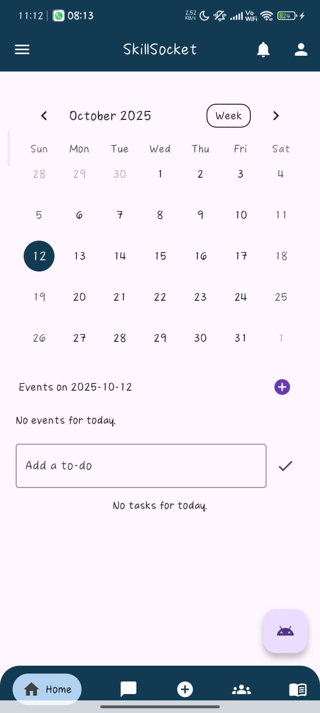
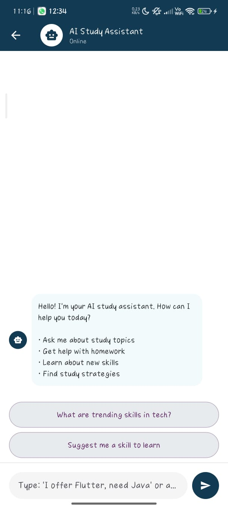
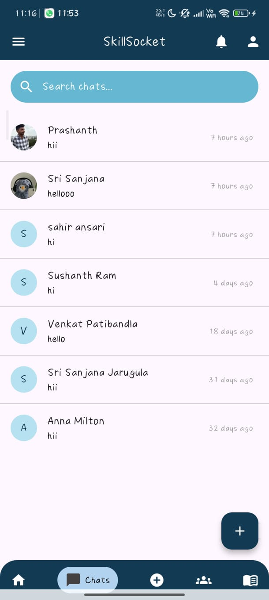
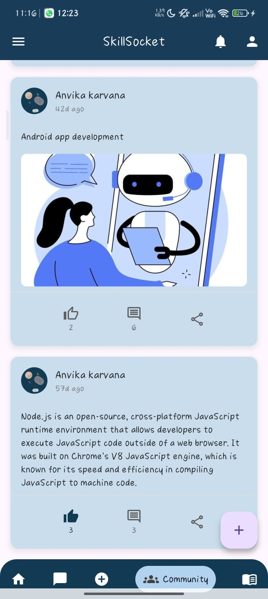
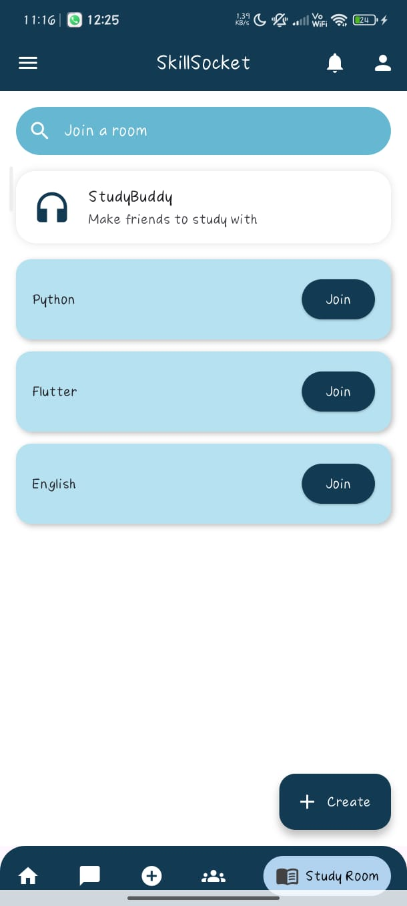
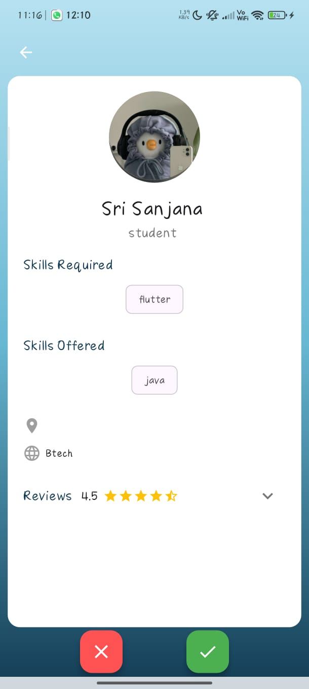

# SkillSocket  
<div style="display: flex; align-items: center;"> 
   
</div>  

---

##  Table of Contents  
- [Abstract](#abstract)  
- [Requirements](#requirements)  
- [How to Use](#how-to-use)  
- [Preview](#preview)  
- [Team Details](#team-details)  
- [Contribution](#contribution)  
- [Improvements](#improvements)  

---

##  Abstract  
SkillSocket is an interactive platform designed to help users **exchange skills, share study materials, and collaborate in real time**.  
It connects learners who want to teach or learn practical skills — from coding and design to art and communication.  

Key features include:  
- Creating and joining **collaboration rooms**  
- **Tinder-like UI** to match profiles and connect with people having common interests  
- **Community space** to discuss, share ideas, and post updates 
- Real-time **chat and connection** between users  
- **Chatbot**: Provides real-time assistance and answers user queries instantly.

The goal of SkillSocket is to make learning more **collaborative, accessible, and meaningful**, bridging the gap between skill-seekers and skill-sharers. 

---

## Requirements  

### Frontend
<pre>
  Package / Library              Version
------------------------------  -----------
  Flutter                         3.0.0 or above
  Dart                            >=3.0.0 <4.0.0
  cupertino_icons                 ^1.0.2
  http                            ^1.0.0
  shared_preferences              ^2.0.0
  url_launcher                    ^6.0.0
  table_calendar                  ^3.0.0
  share_plus                      ^7.0.0
  pie_chart                       ^5.0.0
  image_picker                    ^1.0.0
  intl                            ^0.19.0
  socket_io_client                ^2.0.3+1
  swipable_stack                  ^2.0.0
  flutter_local_notifications     ^17.2.3
  firebase_core                   ^2.15.0
  firebase_messaging              ^14.6.5
  flutter_test                    SDK (for testing)
  flutter_lints                   ^3.0.0
</pre>

### Backend
<pre>
  Node.js                        >=18.0.0
  npm                             >=9.0.0
  MongoDB                         6.0 or above
  express                         ^4.18.2
  socket.io                       ^4.7.2
  mongoose                        ^7.3.1
</pre>

---

## How to Use  
Follow these steps to run the project:  

Clone the Repository:  
```terminal
git clone https://github.com/AAC-Open-Source-Pool/25AACR02.git
```
Navigate to the folder:
```terminal
cd 25AACR02
```
Install flutter dependencies:
```terminal
flutter pub get
```
Launch the App:
```terminal
flutter run
```

---

## Preview 
<div style="display: flex; align-items: center;"> 
 
 
 
 
 
 
 
</div>

---

## Team Details  
<b>Team Number:</b>  
25AACR02    

<b>Senior Mentor:</b>  
Vitesh   

<b>Junior Mentor:</b>  
Prajith   

<b>Team Member 1:</b>  
K. Anvika  

<b>Team Member 2:</b>  
Nakirekanti Prashanth

<b>Team Member 3:</b>  
Jarugula Sri Sanjana

<b>Team Member 4:</b>  
Ghulam Sahir Ansari

---

## Contribution
Understand the project: Read the README to align your changes with the project’s purpose and flow.<br><br>
Use the same technology stack: Make sure your edits use the same versions of languages and libraries.<br><br>
Document your changes: Clearly explain the issue, your solution, and provide example outputs.<br><br>
Submit a Pull Request: Follow standard Git etiquettes for submitting contributions.<br><br>

---

## Improvement
Add video calling for live collaboration<br><br>
Integrate AI skill-matching for better user pairing<br><br>
Add points and badges to gamify learning<br><br>
Enable offline material sharing via Bluetooth or Wi-Fi Direct<br><br>
Calendar integration for scheduling sessions<br><br>